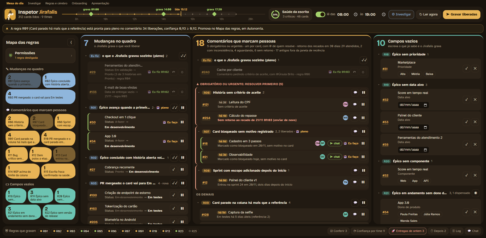
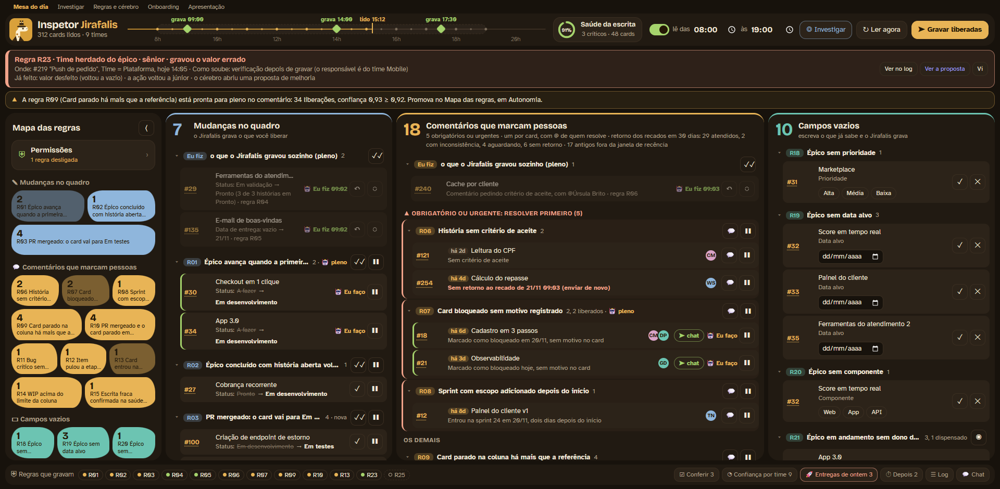
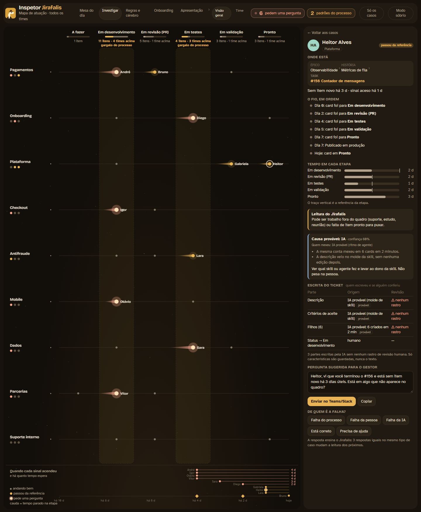
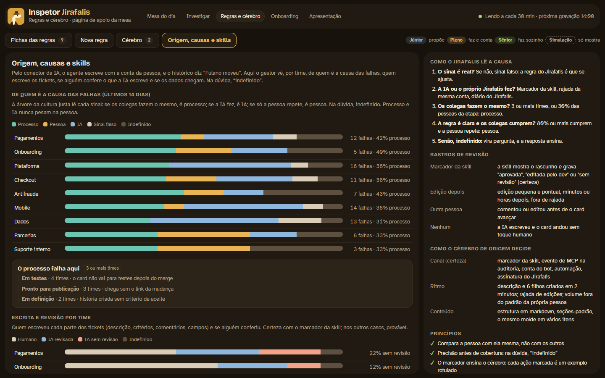

# Inspetor Jirafalis

**Quando o time trabalha com IA, o trabalho anda no PR, no terminal do agente e na conversa, e o card fica para trás. O Jirafalis devolve ao gestor um retrato confiável do fluxo e diz se cada falha veio do processo, da pessoa ou da IA.**

🔗 **Protótipo navegável:** https://sidneydiaraujo.github.io/jirafalis/ (dados fictícios, não precisa instalar nada)



## O problema

Com agentes de IA no time, a daily quase sumiu, as políticas de kanban afrouxaram para o agente trabalhar livre e o gestor perdeu o lugar onde via quem está onde. O quadro mente sem ninguém querer: o PR foi mergeado e o card ficou em desenvolvimento; a história nasceu sem critério de aceite porque a IA escreveu e ninguém revisou. Na hora de cobrar, é fácil culpar a pessoa por uma falha que é do processo ou da IA.

## A solução

O Jirafalis é um **inspetor**: lê a ferramenta de gestão (Jira, Azure DevOps, monday, Asana) e o git, mostra onde cada item está de verdade e transforma o que se repete em **regras que conquistam autonomia** (júnior → pleno → sênior), vigiadas por um cérebro que mede cada ação o tempo todo.

| Pilar | O que faz |
|---|---|
| **Mesa do dia** | A página principal do gestor: o que as regras querem gravar no quadro, os avisos que marcam pessoas e os campos vazios, com Liberar, Suspender, "Eu faço" e "Eu fiz" |
| **Investigar** | Todos os times numa tela, a jornada de cada pessoa entre as etapas e o caso com o fio das evidências |
| **Causa da falha** | Uma árvore de cultura justa diz se a falha é do **processo, da pessoa ou da IA**; na dúvida, "indefinido". Processo e IA nunca pesam na pessoa |
| **Origem e skills** | Cada parte do ticket mostra quem escreveu (humano ou IA) e se houve revisão humana; o erro causado por uma skill de IA volta para a skill que o gerou |
| **Regras conversando** | Um conector (servidor MCP) dentro da IA que o gestor já usa: ele descreve a regra em português, o Jirafalis monta, valida e simula ("hoje pegaria 3 itens") |
| **Cérebro das regras** | A autonomia é de cada **ação** (campo, status, comentário, mensagem), por classe de risco, com confiança estatística explicável. Em sênior, sentinelas rebaixam a ação sozinhas e erro com efeito vira **tarja vermelha** |

**IA com responsabilidade:** a IA entende, descobre e propõe; a execução é determinística, auditável e pode ser desfeita. O Jirafalis nunca escreve sem regra aprovada, e a autonomia é sempre conquistada.

## Telas

| Tela | O que mostra | Arquivo |
|---|---|---|
| Mesa do dia | Ronda do dia, mapa das regras, três raias, permissões, tarja vermelha | [`prototipo/mesa.html`](prototipo/mesa.html) |
| Investigar | Visão geral, o time e o caso, com causa provável e escrita do ticket | [`prototipo/escala.html`](prototipo/escala.html), [`prototipo/constelacao.html`](prototipo/constelacao.html) |
| Regras e cérebro | Fichas das regras, nova regra (com o Claude ou pelo formulário), cérebro, origem, causas e skills | [`prototipo/regras.html`](prototipo/regras.html) |
| Onboarding | Ligar o Jirafalis na IA e mapear o processo em 12 passos | [`prototipo/onboarding.html`](prototipo/onboarding.html) |
| Apresentação | O documento completo do produto | [`index.html`](index.html) |





> **O catálogo de regras do protótipo é ilustrativo.** As regras (R01, R02…) são regras comuns de Scrum e Kanban, como card parado há mais que a referência, WIP acima do limite da coluna, história sem critério de aceite e bug crítico sem responsável, escolhidas só para mostrar o funcionamento. Pessoas, times e cards são fictícios.

## Arquitetura (resumo)

```
 Ferramentas (Jira, Azure DevOps, monday, Asana) + git + chat do time
        │  conectores (API/webhooks) ou o MCP do próprio usuário
        ▼
 Modelo canônico do processo ── Motor de regras (determinístico, simulação, desfazer, fila única de escrita)
        │                                │
        ▼                                ▼
 Mapa de atuação                  Cérebro das regras: observador · log de evidências · avaliador ·
 (painel web)                     promotor · analista de melhorias · replay · guardião (sentinelas)
        ▲
 Conector MCP do Jirafalis (claude.ai, Claude Code e outros clientes MCP)
```

## Validação em operação real

*Declaração do autor.* O núcleo do Jirafalis (motor de regras com simulação, autonomia júnior → pleno, painel e avisos no chat) foi construído e usado por mim em operação real, com uma suíte de **721 testes automatizados em C#/.NET 10 com xUnit**. Aquele código pertence ao ambiente onde foi usado e não está neste repositório; aqui ficam o produto, o protótipo e a documentação, com dados fictícios.

## Meu papel

Fiz o produto de ponta a ponta, como Scrum Master que constrói as ferramentas que faltam:

- **Discovery:** a dor do gestor de times que trabalham com IA e o mapa do que o mercado não resolve.
- **Desenho do processo:** a árvore de cultura justa (processo, pessoa ou IA), o ciclo de autonomia das regras e as travas de escrita.
- **Regras de decisão:** classes de risco, limiares de confiança, promoção, rebaixamento e sentinelas.
- **Protótipo:** todas as telas deste repositório, navegáveis e com dados fictícios.
- **Orquestração com IA:** construção com o Claude Code, com agentes, skills e revisão.

## O que este projeto mostra

- **Produto:** do problema real à proposta de valor, com onboarding, fluxo diário e plano de autonomia.
- **Gestão ágil:** fluxo, WIP, critérios de aceite e cultura justa aplicados à governança de times que usam IA.
- **IA aplicada:** IA que propõe e explica; execução determinística, auditável e reversível.
- **Arquitetura:** modelo canônico do processo, motor de regras, conector MCP e cérebro que mede as próprias ações.

## Como ver

Abra o [protótipo publicado](https://sidneydiaraujo.github.io/jirafalis/) ou clone o repositório e abra `index.html` no navegador. Não há build nem dependências.

## Licença

© 2026 Sidney de Araujo Silva. Todos os direitos reservados. O conteúdo está público só para leitura; veja [LICENSE](LICENSE).
Fontes: Bricolage Grotesque e Atkinson Hyperlegible (SIL Open Font License, via Google Fonts).
